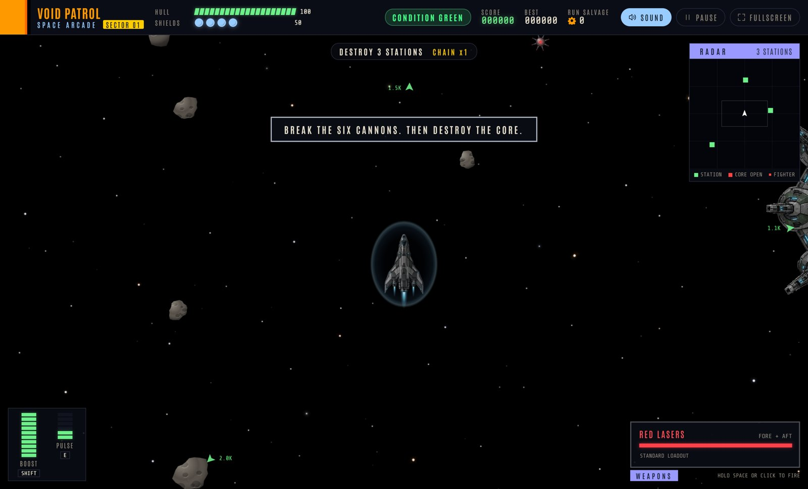

# Void Patrol

A free-roaming space arcade shooter in the spirit of the 1981 classic Bosconian.
Fly a ship that never stops moving, break the six cannons on each fortress, blow
out its core, survive a dreadnought every fifth sector, and upgrade your ship
between sectors.



## Play

**In your browser, nothing to install:** https://huntermixhunter.github.io/void-patrol/

**Download for your computer:** grab the latest build from the Releases page:
https://github.com/huntermixhunter/void-patrol/releases/latest

| System | File | How |
| --- | --- | --- |
| Windows | `VoidPatrol-Setup-<version>.exe` | Run it. It installs in seconds with no admin rights, adds Desktop and Start menu shortcuts, and starts the game. |
| Windows, no install | `VoidPatrol-<version>-Portable.exe` | Save it anywhere and double-click. |
| Mac | `VoidPatrol-<version>-mac.dmg` | Drag Void Patrol into Applications. |
| Linux | `VoidPatrol-<version>-linux.AppImage` | Mark it executable and run it. |

The builds are not code-signed, so the first launch asks for one extra click:

- **Windows:** if SmartScreen says "Windows protected your PC", click **More info**, then **Run anyway**.
- **Mac:** open the app once, then go to System Settings > Privacy & Security and click **Open Anyway**.

The desktop app works fully offline. Your hangar upgrades, salvage, and records
are saved on your computer.

## How to play

1. Pick a difficulty on the title screen and launch. Green squares on the radar
   and arrows at the screen edge lead to the stations.
2. Each station has six cannon pods. Destroy all six to expose the core, then
   destroy the core. The core hatch also cycles open every few seconds: one shot
   into the open core destroys the whole station for a 1,500-point direct hit.
3. Clear every station to finish the sector, then install one of three upgrades.
4. Every fifth sector is a dreadnought fight. Knock out its gun batteries to drop
   its shield, dodge the plasma rings, then destroy the hull.
5. Collect salvage and spend it in the hangar on permanent hull, shield, engine,
   and weapons upgrades between runs.

Formations fly in a V behind a gold-ringed leader: kill the leader for a bonus
and the rest scatter. Shoot cosmo-mines to set off chain blasts. Consecutive
kills build a score multiplier. The longer you stay in a sector, the more the
condition rises from GREEN to YELLOW to RED.

**Lasers:** your cannons fire red lasers at the start of every run. Install
**Heavy rounds** (the damage upgrade) and they switch to blue. Fire rate and
Split shot upgrades do not change the color.

### Difficulty

| Level | Enemy toughness | Enemy damage | Fire rate | Score |
| --- | --- | --- | --- | --- |
| Cadet | x0.8 | x0.7 | x0.75 | x0.75 |
| Pilot (default) | x1 | x1 | x1 | x1 |
| Veteran | x1.15 | x1.25 | x1.25 | x1.5 |
| Ace | x1.3 | x1.45 | x1.5 | x2 |

### Controls

| Control | Action |
| --- | --- |
| Mouse | Point where you want to fly |
| WASD or arrow keys | Steer |
| Space or left mouse button | Fire (hold to repeat) |
| Shift | Boost |
| E | Pulse: clears nearby fighters, shots, and mines |
| P or Escape | Pause |
| F | Fullscreen |
| M | Sound on or off |
| Enter | Launch |
| Gamepad | Left stick steers, A or RB fires, B or RT boosts, X or Y pulses, Start pauses |
| Touch | Virtual stick steers; hold FIRE and BOOST; tap PULSE |

## Run from source

Requires Node.js 20 or newer.

```bash
npm install
npm start          # desktop window
npm run web        # browser version at http://localhost:8080/
npm test           # 31 simulation tests
npm run smoke      # launches the desktop app headlessly and fails on any error
npm run dist:win   # build the Windows installer and portable exe into dist/
```

Opening `game/index.html` straight from disk does not work, because browsers
block JavaScript modules on `file://`. Use `npm run web` or the desktop app.

### Releasing

Push a version tag and GitHub Actions builds Windows, Mac, and Linux packages
and attaches them to a new release:

```bash
npm version patch   # or minor / major
git push --follow-tags
```

Every push to `main` also republishes the browser version on GitHub Pages.

## Project layout

- `game/engine.mjs`: deterministic simulation and upgrade economy, stepped in fixed 1/120-second ticks.
- `game/renderer.mjs`: Canvas 2D rendering, particles, and radar.
- `game/game.mjs`: input, audio, progression, menus, and saving.
- `game/index.html`, `game/style.css`: the page, HUD, and screens.
- `game/assets/`: sprites, sounds, and bundled fonts.
- `desktop/main.js`: the Electron desktop shell.
- `tools/build_arcade_sounds.py`: regenerates the original synthesized sound effects with NumPy.

## License

Code, artwork, and sounds: Apache License 2.0, see `LICENSE`. The sound effects
are original and procedurally synthesized. The bundled Antonio and Share Tech
Mono fonts are under the SIL Open Font License 1.1.
